# Dockside: architecture and development guide

This guide explains the application as it is implemented in this repository: what each part owns, how requests
and measurements move through it, why the boundaries were chosen, and how to develop and verify a change.
It is intended for someone opening the project for the first time.

The diagrams use Mermaid. GitHub and Markdown viewers with Mermaid support render them as flowcharts;
in other viewers, the diagram source remains readable. Paths below link directly to the implementation.
Those implementation links target the source checkout. The runtime release contains bundles and documentation,
so source/test links should be followed from this repository rather than from an extracted runtime archive.

## Contents

1. [The application in one minute](#1-the-application-in-one-minute)
2. [Technology choices and boundaries](#2-technology-choices-and-boundaries)
3. [Repository map and reading order](#3-repository-map-and-reading-order)
4. [How the application was developed](#4-how-the-application-was-developed)
5. [Startup, background work and shutdown](#5-startup-background-work-and-shutdown)
6. [First-run setup, login and request security](#6-first-run-setup-login-and-request-security)
7. [Database model and persistence](#7-database-model-and-persistence)
8. [Host collection and metric history](#8-host-collection-and-metric-history)
9. [HTTP and TCP service checks](#9-http-and-tcp-service-checks)
10. [Alert evaluation and notifications](#10-alert-evaluation-and-notifications)
11. [Docker inspection, logs and restart](#11-docker-inspection-logs-and-restart)
12. [Frontend navigation, state and accessibility](#12-frontend-navigation-state-and-accessibility)
13. [Local preview and Linux deployment](#13-local-preview-and-linux-deployment)
14. [Testing, packaging and release evidence](#14-testing-packaging-and-release-evidence)
15. [A practical guide to making a change](#15-a-practical-guide-to-making-a-change)
16. [Boundaries and troubleshooting](#16-boundaries-and-troubleshooting)

## 1. The application in one minute

Dockside is a private monitoring console for a small fleet of Linux servers. An administrator connects exporters,
configures service checks and alert thresholds, and manages local accounts. Operators investigate incidents;
viewers inspect the same fleet with fewer permissions. Everyone uses one shared fleet and one configured Docker
endpoint. Accounts are local to Dockside; no external identity or analytics service is required.

The browser displays information collected or fetched by the API. It does not contact exporters, Docker sockets
or notification providers directly. A single Node process serves the built frontend, JSON API and background
scheduler. SQLite stores configuration, history, accounts and audit records.

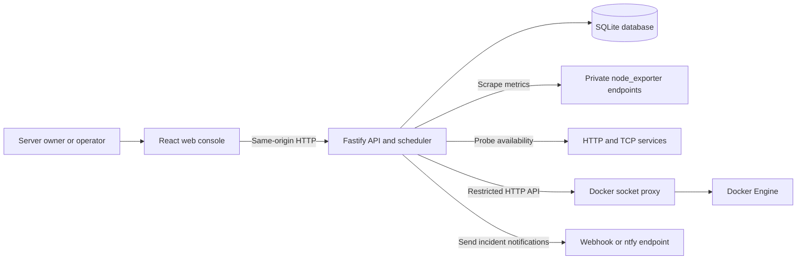

There are two independent clocks: the **server collection interval** measures sources, while the **browser refresh
interval** reloads stored results. Refreshing a screen does not force a host scrape. Rates need two usable
scrapes; missing measurements appear as gaps or unavailable values.

## 2. Technology choices and boundaries

| Part               | Implementation                                    | Why this boundary exists                                                                                 |
| ------------------ | ------------------------------------------------- | -------------------------------------------------------------------------------------------------------- |
| Workspace          | npm workspaces and TypeScript                     | Share contracts while keeping browser and server responsibilities separate.                              |
| Web UI             | React 19, React Router 7, Vite 7                  | Components and routes own interaction; Vite produces static production assets.                           |
| Server-state cache | TanStack React Query 5                            | Own loading, refresh, retries and cache invalidation without duplicating remote data in component state. |
| HTTP server        | Fastify 5                                         | Compose authentication, guards, validation, routes and static serving in one process.                    |
| Wire contracts     | Zod 4 in `packages/shared`                        | Validate input and responses at runtime as well as checking types during development.                    |
| Persistence        | Node's built-in `node:sqlite`, WAL mode           | Keep the private installation small, with no separate database server.                                   |
| Cryptography       | Node crypto: scrypt, SHA-256, AES-256-GCM         | Hash passwords, hash session identifiers and encrypt notification destinations for distinct purposes.    |
| Charts and design  | Original SVG components and CSS tokens            | Keep chart behavior, keyboard inspection, themes and reduced motion under application control.           |
| Tests              | Vitest, React Testing Library, Playwright and axe | Verify calculations, real SQLite/network behavior, screen interactions and browser accessibility.        |
| Packaging          | Vite assets, esbuild API bundle, tar and SHA-256  | Produce an extracted release that runs with Node without installing application dependencies.            |

The lockfile records exact installed versions. This is a modular application within one server process; the
services below are classes with clear responsibilities, not independently deployed network services.

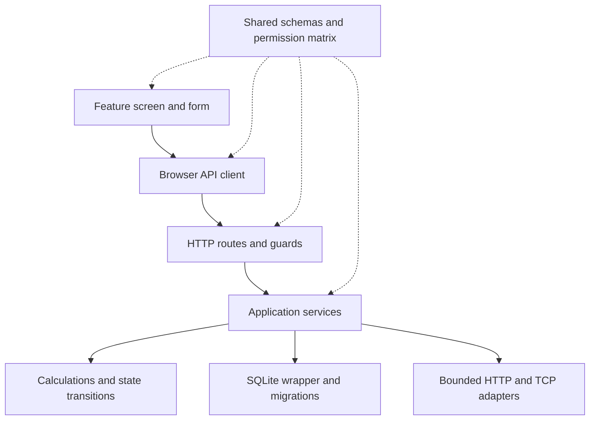

Routes translate HTTP into service calls. Services coordinate persistence and adapters. Domain functions handle
rate calculations, log framing and alert decisions without depending on React or Fastify. This separation makes
the most failure-prone behavior testable with explicit inputs and clocks.

## 3. Repository map and reading order

```text
Dockside/
  apps/
    api/
      src/
        main.ts                 Process startup and shutdown
        app.ts                  HTTP plugins, routes, errors and SPA serving
        config.ts               Validated environment settings
        context.ts              Service construction and shared dependencies
        db/                     SQLite wrapper and migrations 001-004
        domain/                 Metrics, parsing, alerts, passwords and secrets
        plugins/auth.ts         Session resolution, CSRF and permission guards
        routes/                 Authentication, hosts, operations, alerts and admin
        services/               Persistence and integration orchestration
      tests/                    API, SQLite, socket and permission tests
      scripts/build.mjs         Server bundle build
    web/
      src/
        main.tsx                React providers and CSS initialization
        App.tsx                 Session gate and route tree
        components/             Shell, charts, tables, confirmations and states
        features/               Screens and their forms
        lib/                    API client, query cache, preferences and formatting
        styles/                 Design tokens, layout, components and charts
  packages/shared/src/          DTO schemas, metric definitions and roles
  scripts/                     Bootstrap, sample runner, checks and release tools
  deploy/                      HAProxy policy and optional Caddy configuration
  e2e/                         Packaged browser journeys
  qa/                          Screenshots and verification evidence
  docs/                        Decisions, API, release and limitations
  compose.yaml                 Linux deployment topology
  Dockerfile                   Build and non-root runtime image
```

A useful reading order is [shared roles](packages/shared/src/roles.ts),
[shared monitoring schemas](packages/shared/src/monitoring.ts), [server startup](apps/api/src/main.ts),
[context construction](apps/api/src/context.ts), [host service](apps/api/src/services/hosts.ts), then
[frontend routing](apps/web/src/App.tsx) and [host screen](apps/web/src/features/hosts/HostPage.tsx).

## 4. How the application was developed

The build progressed through five functional milestones. Authentication was brought into the foundation stage
so monitoring routes would be protected from their first implementation. The detailed decision record is in
[ADR.md](docs/ADR.md); the milestone summary below describes the implementation sequence.

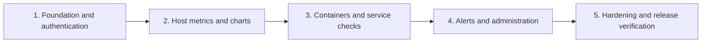

| Milestone           | What was built                                                                                                 | How its behavior was checked                                                                               |
| ------------------- | -------------------------------------------------------------------------------------------------------------- | ---------------------------------------------------------------------------------------------------------- |
| Foundation          | Config validation, SQLite wrapper, migrations, accounts, sessions, CSRF, audit, health endpoints and app shell | Config, migration, password, session, permission and authentication tests                                  |
| Monitoring          | Exporter parser, counter baselines, rates, metadata, history, retention, host inventory and accessible charts  | Fixtures for malformed input, resets, gaps, stale timestamps, cardinality, retention and chart interaction |
| Operations          | Docker adapter, hidden-container rules, bounded logs, HTTP/TCP checks and history                              | Protocol fixtures, real local HTTP/TCP sockets, role denials and screen workflows                          |
| Incidents and admin | Alert state machine, encrypted channels, asynchronous delivery, users and audit screens                        | Fake-clock transitions, missing-data cases, retries, encryption, confirmation and last-admin protection    |
| Release             | Production bundle, labelled sample runner, Compose/TLS recipes, CI, browser QA and archive tooling             | Coverage gates, fresh-source installation, Edge journeys, axe scans and extracted-archive smoke tests      |

The interface uses a harbour-office direction: warm light surfaces, a dark harbour theme, ruled tables,
self-hosted fonts and status words/glyphs alongside colour. Shared controls were extracted for repeated tables,
error states and confirmations. Failed requests keep form drafts and show errors instead of reporting success.

Sample services were added to make development and browser testing repeatable on Windows. Their measurements
are visibly simulated. They establish application behavior and do not establish real Linux/Docker compatibility.
Changes remain uncommitted at the owner's request; these milestones describe implementation work, not Git tags.

## 5. Startup, background work and shutdown

The entry point is [main.ts](apps/api/src/main.ts). The ordinary `npm start` command lets Node read root `.env`
before application code runs. The sample runner supplies an isolated environment instead.

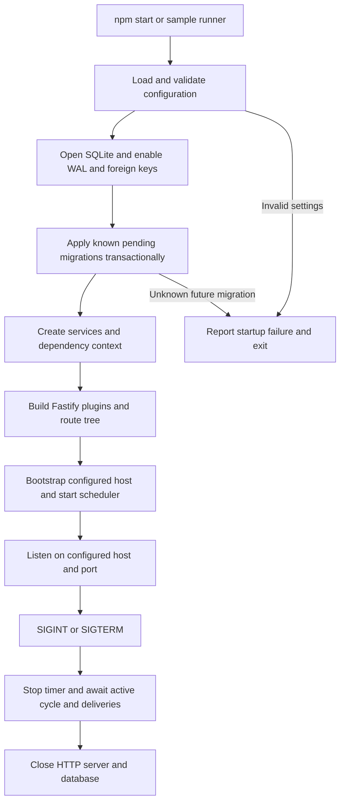

`createContext()` constructs services once and injects configuration, the database and a clock. Tests can
substitute an in-memory database, local protocol fixtures and a controlled clock without changing route code.

The scheduler runs once immediately, then attempts a cycle at `SCRAPE_INTERVAL_SECONDS` intervals. It does not
start an overlapping cycle when the previous one is still running. Host collection and check execution each use
at most four workers. Within a cycle the stages run in this order:

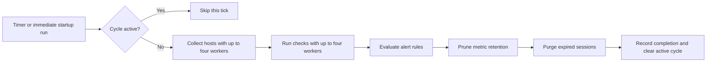

An unexpected cycle error marks the collector degraded and allows a later cycle to retry. Individual failed
exporter reads are recorded on the host. Notification delivery runs asynchronously; shutdown waits for outstanding
delivery tasks. There is no separate worker process or durable job broker.

`/healthz` is simple process liveness. `/readyz` reports component states without private detail and returns 503
when a component fails. A degraded collector is visible but does not by itself make the API unready. Signed-in
users can read richer component details at `/api/v1/status` and on the Settings screen.

## 6. First-run setup, login and request security

### Browser entry and local accounts

`App.tsx` begins with `GET /api/v1/session`. It uses the response to choose the screen; the API remains the
authority on what the account may do.

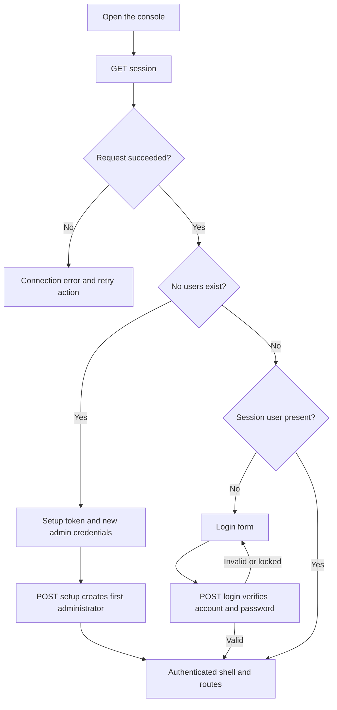

`scripts/bootstrap.mjs` creates `.env` with random encryption and setup secrets and refuses to overwrite an
existing file. The setup route only works while no users exist, compares the setup token using constant-time
comparison, and rechecks the empty-user condition inside the account-creation transaction.

Passwords are salted scrypt hashes. Login gives a generic failure for unknown, incorrect, disabled or locked
accounts; unknown names still perform a password-hash verification. Five failed passwords cause a five-minute
account lock. The default password minimum is 12 characters.

### An authenticated mutation from screen to database

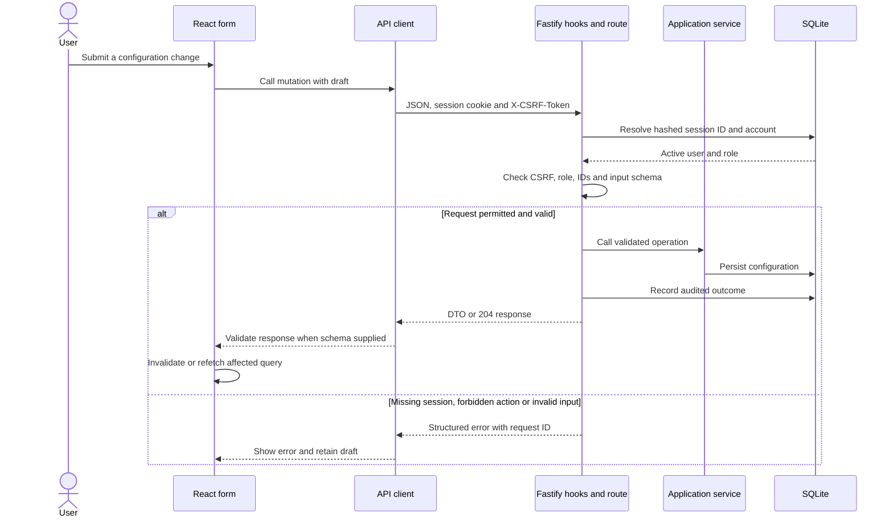

The session cookie is HttpOnly, SameSite Strict and scoped to `/`. With `BEHIND_TLS_PROXY=true`, it becomes
Secure and is named `__Host-dockside`. SQLite stores a SHA-256 hash of the random session ID, not the cookie's
raw identifier. Sessions expire after two idle hours or twelve absolute hours; last-seen updates are throttled.
The CSRF token is stored in browser memory and attached to mutations, rather than saved in localStorage.

Authenticated unsafe requests pass the CSRF hook. Protected routes require a session and their named permission.
Role denials and CSRF failures are audited. The UI uses the same permission matrix to show useful controls, but
hiding a button never replaces server authorization.

| Capability                                                  | Viewer | Operator | Admin |
| ----------------------------------------------------------- | ------ | -------- | ----- |
| Read fleet metrics, containers, checks, alerts and settings | Yes    | Yes      | Yes   |
| Read container logs                                         | No     | Yes      | Yes   |
| Run checks, acknowledge and silence alerts                  | No     | Yes      | Yes   |
| Request a restart when all feature gates allow it           | No     | Yes      | Yes   |
| Manage hosts, checks, rules, channels and users; read audit | No     | No       | Yes   |

The full matrix is [roles.ts](packages/shared/src/roles.ts). User role/disabled updates revoke that user's
sessions. A password change revokes the user's other sessions. The last enabled administrator cannot be
disabled or demoted.

## 7. Database model and persistence

[database.ts](apps/api/src/db/database.ts) wraps prepared statements, transactions and nested savepoints.
Foreign keys are enabled. WAL mode and a busy timeout support the small private console's access pattern;
this is a single-instance SQLite design with synchronous database calls.

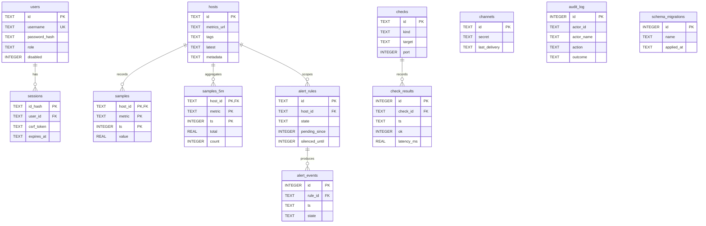

The diagram lists representative columns; the migrations are authoritative for the complete schema.
`audit_log.actor_id` is a recorded reference, not an enforced foreign key. Audit history therefore remains
separate from account/session lifecycle. Channels are global destinations: there is no rule-to-channel join
table. Silences live on `alert_rules.silenced_until`, rather than in a separate silence table.

| Migration     | Tables added                              |
| ------------- | ----------------------------------------- |
| `001_core`    | `users`, `sessions`, `audit_log`          |
| `002_metrics` | `hosts`, `samples`, `samples_5m`          |
| `003_checks`  | `checks`, `check_results`                 |
| `004_alerts`  | `alert_rules`, `alert_events`, `channels` |

The migration runner also maintains `schema_migrations`. Each pending migration is transactional and applied
in numeric order. A database containing an unknown migration ID prevents startup, protecting against an
accidental downgrade. There is no automatic down-migration system.

Users, hosts, checks, rules and channels use UUIDs. Audit/event/history IDs and migration IDs are integers;
sessions are addressed by hashes, and Docker containers by validated Engine IDs. Metric sample timestamps are
epoch seconds in SQLite and epoch milliseconds in chart responses. Session/check/event dates use UTC ISO strings;
alert pending/silence timestamps use epoch seconds.

Deleting a host cascades to its raw samples, rollups, rules and rule events. Deleting a check removes its history.
Changing host configuration resets its current metadata and in-memory counter baseline, while retaining history.
Backups need the stopped database, any WAL/SHM sidecars, deployment configuration and the matching `SECRETS_KEY`.
Restore into a stopped instance using a compatible application version and its matching backup. A newer build
may apply forward migrations; restoring data is not an automatic database downgrade.
See [release and rollback](docs/RELEASE.md) for the operating procedure.

## 8. Host collection and metric history

The host route module validates configuration; [HostService](apps/api/src/services/hosts.ts) owns inventory,
collection, persistence, derived host status and historical-series queries.

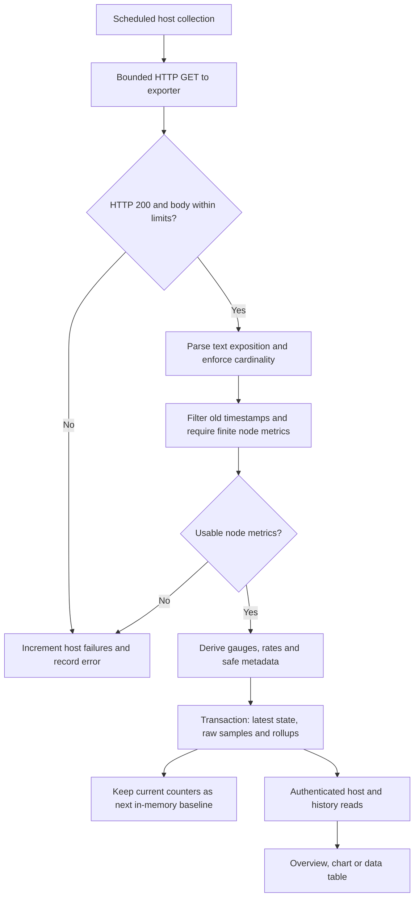

The HTTP adapter rejects redirects, credentials in URLs and prohibited metadata destinations. Its default
deadline is five seconds and response cap is 5 MiB. Parsing admits at most 256 metric-name families, 4,096 series
and 24 labels per sample. Invalid, duplicate or excessive series are counted as dropped. The parser handles
label escapes and non-finite numeric exposition; derived values use finite inputs.

### Gauges and counter rates

Memory, load, filesystem capacity and temperature are derived from current gauge readings. CPU and throughput
depend on differences between two counter snapshots:

```text
throughput = (new byte counter - previous byte counter) / elapsed seconds
CPU percent = (1 - idle CPU rate / total CPU rate) * 100
memory used = total memory - available memory
```

CPU calculation excludes guest/guest-nice counters from the summed modes. The application omits loopback from
network totals and loop/ram devices from the relevant aggregates. A first sample, counter reset, missing baseline,
non-increasing time or gap longer than three collection intervals produces an unavailable rate. For example,
1,000 bytes followed by 1,750 bytes after five seconds yields 150 B/s; a reset to 20 bytes yields a gap.

Baselines live in memory and are rebuilt after restart. Stored gauges and history remain, while new rates need
another pair of usable scrapes. A failed collection preserves the last successful values and timestamp; it does
not write fake zeroes or advance the successful baseline.

Only eligible filesystem capacity metadata is retained. Pseudo filesystems and sensitive mount prefixes such
as `/etc`, `/root`, `/run` and container-storage paths are excluded. No filesystem browsing is provided.
Temperature sensors appear only when the exporter exposes them.

### Status and history selection

| Status  | Rule used when reading the host                                                             |
| ------- | ------------------------------------------------------------------------------------------- |
| Online  | Successful readings are recent and no consecutive failure is recorded.                      |
| Stale   | No reading yet, one or two failures, or last success older than three collection intervals. |
| Offline | Three or more consecutive collection failures.                                              |

The API stores raw derived points and incrementally maintains five-minute `total`/`count` buckets. A repeated
sample for the same host/metric/second does not add another raw point or count it twice in the rollup.

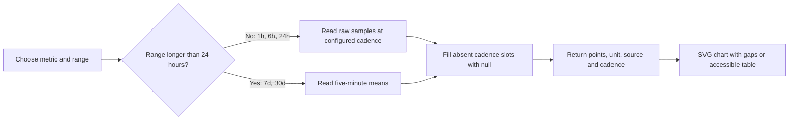

Raw retention defaults to three days; rollups default to 90 days. Retention runs in the scheduler, independently
of whether anyone has the UI open. A short configured raw retention can leave part of a 24-hour chart empty.
Rollups are means of available readings, including partial buckets, and do not preserve raw peaks.

## 9. HTTP and TCP service checks

Checks measure reachability **from the Dockside server**. A browser being able to reach a URL does not establish
that the API's host or container can reach it.

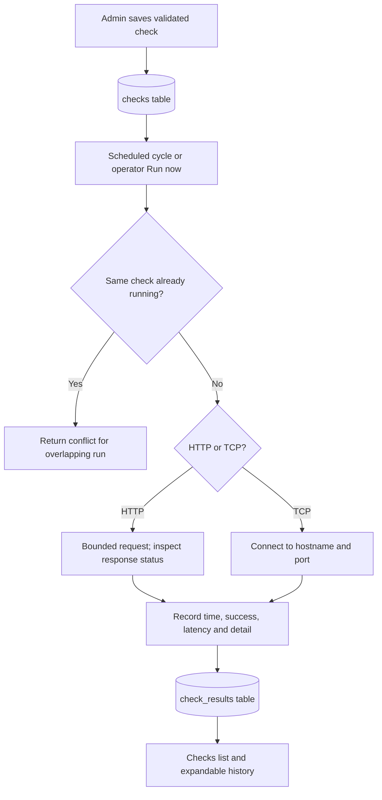

HTTP checks use the shared URL rules, a five-second deadline and a 64 KiB response cap. The success-status test
accepts 2xx/3xx, while actual redirects are rejected by the adapter. TCP checks have a five-second socket timeout
and reject the explicit prohibited metadata targets. Failures become persisted results with an explanatory
detail rather than disappearing from history. Input validation and network policy are described in the threat
model; these rules do not provide general DNS-rebinding isolation.

The application allows up to 100 configured checks. It keeps at most 1,000 stored results per check and returns
the latest 100 in each check DTO. There is no separate per-check scheduler or custom per-check interval.

## 10. Alert evaluation and notifications

Rules watch a derived metric on one host using `gt` or `lt`, a threshold and a required breach duration. The
scheduler evaluates them after host and check work. Current check outcomes are not alert-rule inputs in v1.
Only an online host contributes its current value; stale/offline input is treated as missing.

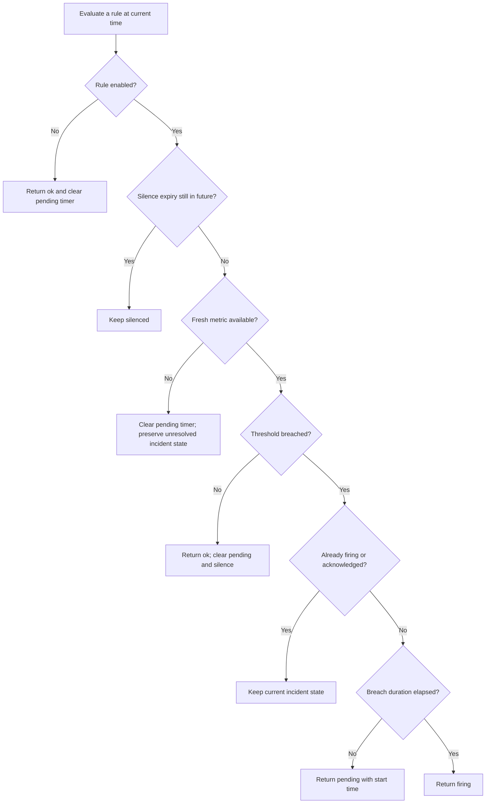

The states exposed to the UI are `ok`, `pending`, `firing`, `acknowledged` and `silenced`. A zero-duration rule can
fire on its first breached evaluation. Operators may acknowledge a firing incident or silence a rule for a
validated duration. Editing rule configuration resets its state and timers.

Missing data does not establish recovery. A pending rule with missing input returns to `ok` and starts duration
counting again when data returns. Firing and acknowledged incidents stay unresolved. An expired silence with no
new data can remain `silenced`; a fresh measurement is needed to establish its next condition.

State changes and events are written in a transaction. Fresh firing transitions and qualifying fresh recoveries
start delivery to **every configured channel**; pending, acknowledgement and silence events do not send a new
notification. Channels store an encrypted JSON payload containing URL and token. API responses return
`[encrypted]` and `[masked]`, not the original destination or credentials.

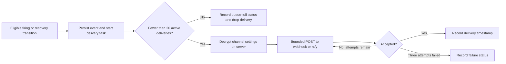

Webhook bodies contain a Dockside source and message; ntfy-style destinations receive plain text. A configured
token is sent as a Bearer authorization header. The implementation retries immediately, up to three attempts,
with bounded request time and response size. Delivery does not block further evaluator work.

This is an in-process task set, not a durable queue. A process crash can lose a pending delivery; retries can
produce duplicates. Remote provider effects cannot be rolled back with the SQLite transaction. There is no
provider receipt or guaranteed-delivery contract.

## 11. Docker inspection, logs and restart

Docker access is configured through a restricted HTTP proxy. The browser sends application API requests;
only the proxy in the Linux stack mounts `/var/run/docker.sock`.

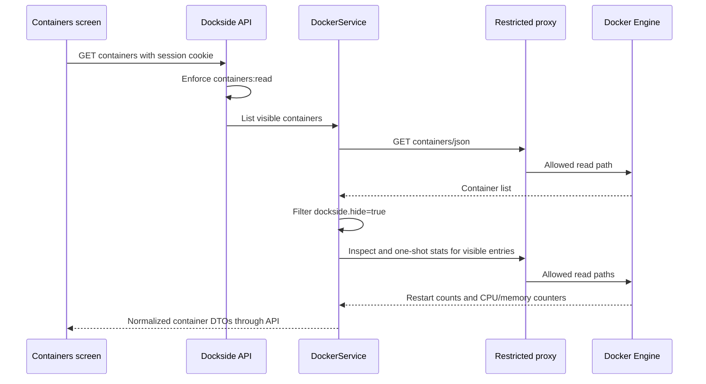

Container lists larger than 1,000 entries are rejected by validation; at most 100 visible entries are enriched
for the UI. Missing inspect/stats data is represented as unavailable without inventing readings. Container CPU
can exceed 100% when multiple cores are used.

Logs require `containers:logs`. The adapter verifies that the requested ID exists in the visible list, checks
inspect labels again, requests a bounded non-following log page, and removes Docker's multiplexing headers when
present. Responses include text, truncation and an optional timestamp cursor for older logs. The newest page
may poll at the browser refresh interval. There is no live WebSocket or SSE log stream.

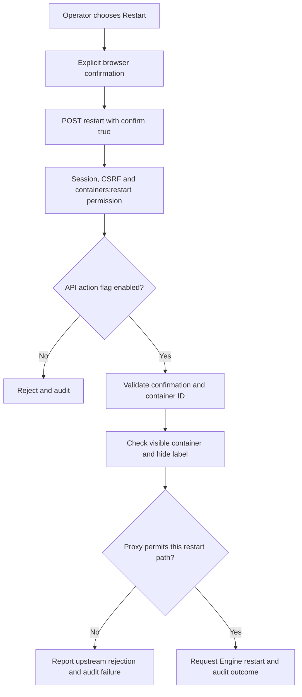

Both `CONTAINER_ACTIONS_ENABLED=true` and `DOCKER_PROXY_ALLOW_RESTART=1` are needed in the supplied deployment.
The default is read-only operation. A read-only bind mount of a socket does not itself constrain Engine methods;
the HAProxy path/method policy is the relevant restriction. Logs can contain application secrets, so log reads
are permission-restricted and audited.

## 12. Frontend navigation, state and accessibility

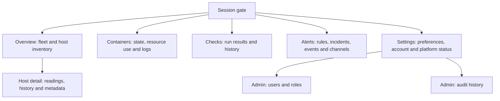

| State                                                            | Owner                              | Lifetime                                              |
| ---------------------------------------------------------------- | ---------------------------------- | ----------------------------------------------------- |
| Accounts, permissions, host/check/rule configuration and history | API services and SQLite            | Persists across server restarts                       |
| Counter baselines, running-check locks and active deliveries     | API service memory                 | Recreated after restart                               |
| Server DTOs, loading/error state and refetch timing              | React Query                        | Browser query-cache lifetime                          |
| Session identity and feature flags                               | Session query and auth context     | Refreshed from API; server remains authoritative      |
| CSRF token                                                       | Browser API module memory          | Cleared on unauthenticated response                   |
| Selected metric/range, open form, log cursor and draft fields    | Feature component state            | Current mounted interaction                           |
| Theme, motion and refresh preferences                            | Validated localStorage preferences | Persists per browser; corrupt values fall back safely |

`api.ts` sends same-origin credentials and maps structured server errors into `ApiError`. Screens supply shared
response schemas for validated reads. An unauthenticated response invalidates the session query and returns the
UI to login with an expiry notice. The query client retries eligible transient query failures up to twice;
mutations do not receive an automatic retry policy that might duplicate creates.

Two network-level failures trigger the disconnected notice; a successful request clears that state. Error
handling distinguishes an unavailable server from a valid empty list. Mutations refresh affected queries only
after success, and drafts survive rejected writes. No optimistic success is fabricated.

There are five primary navigation destinations. The desktop rail becomes a bottom navigation bar on mobile.
Charts preserve null gaps, expose source/unit/cadence, support arrow-key inspection and provide a table view.
Tables can scroll within their regions without forcing page overflow. Focusable regions, labelled controls,
status text, reduced motion and both themes are covered by the local UI/browser verification.

## 13. Local preview and Linux deployment

### Labelled sample preview

`npm run sample` starts a loopback-only application plus two protocol fixtures. It forces sample mode on,
disables restart, and keeps its database and credentials under `data/sample`, separate from the real console.
The sample runner refuses to reuse occupied ports and does not terminate other applications.

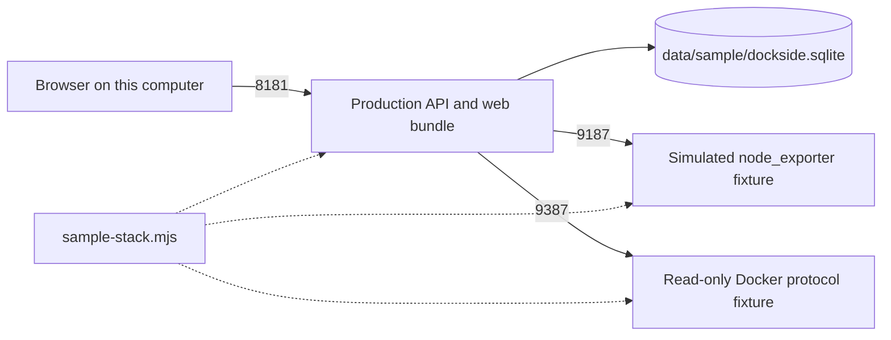

The first visit shows account setup. Read `data/sample/setup-token`, choose an admin username and password,
then allow two five-second scrapes for counter-based readings. The sample encryption key and setup token stay
in local files. There is no hardcoded shared demo password. Stop a foreground runner with Ctrl+C.

### Intended Linux stack

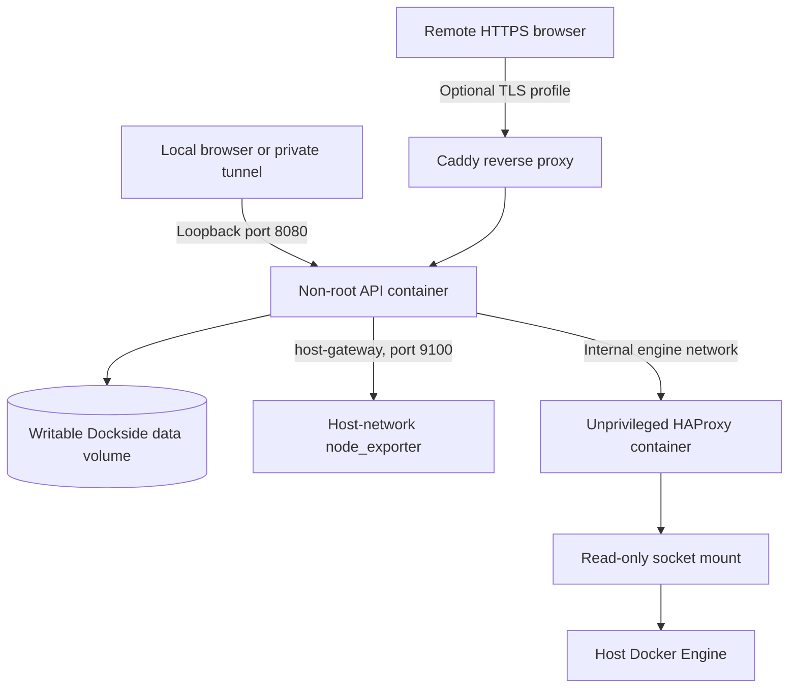

The API has a read-only root filesystem, a writable data volume and dropped capabilities. It publishes
`127.0.0.1:8080`; the proxy publishes no host port and joins an internal network. Node exporter uses host network
and PID namespaces with a read-only host filesystem mount, and binds to the configured private Docker bridge
address. Socket group and bridge address settings depend on the Linux machine.

For Caddy TLS, configure the domain, `BEHIND_TLS_PROXY=true` and `TRUSTED_PROXY_HOPS=1`. Secure cookies then require
the HTTPS origin. Exporters and Docker proxies must remain private. The concrete commands and rollback process
are in [docs/RELEASE.md](docs/RELEASE.md).

This topology is authored and statically checked. A clean Linux Compose startup, real Engine actions, TLS
certificate flow and remote CI run remain unverified in this environment.

## 14. Testing, packaging and release evidence

Tests are placed close to the behavior they verify, with broader integration and browser coverage at the
application boundary. The injected clock makes session expiry, alert durations and retention deterministic.

| Layer            | Evidence and purpose                                                                                       |
| ---------------- | ---------------------------------------------------------------------------------------------------------- |
| Shared contracts | Permission matrix, validation and wire-contract tests                                                      |
| API              | Real SQLite, auth/CSRF/RBAC, metrics, persistence, local sockets, Docker fixtures and failure cases        |
| Web              | Forms, permissions, rejected drafts, session/network recovery, charts and preferences                      |
| Browser          | Setup, login, host/chart/check/alert/log journey; responsive/theme, text scaling and reduced-motion checks |
| Accessibility    | axe scans at 320px and desktop in both themes on six main screens                                          |
| Deployment       | Structural Compose restrictions; actual Docker execution is a separate gate                                |
| Archive          | Extracted file integrity, source agreement, bootstrap, account setup, CSRF, logout and restart persistence |

```mermaid
flowchart LR
  Install[npm ci from lockfile] --> Format[Formatting and lint]
  Format --> Types[Strict TypeScript checks]
  Types --> Coverage[Unit and integration coverage gates]
  Coverage --> Build[Web assets and API bundle]
  Build --> Browser[Packaged browser journeys and axe]
  Browser --> Archive[Release archive and hashes]
  Archive --> Extract[Extract into isolated temporary directory]
  Extract --> Smoke[Integrity, authentication and persistence smoke test]
  Smoke --> Evidence[QA evidence and release manifest]
```

`npm run verify` runs formatting, lint, type checks, coverage and builds. It does **not** include E2E or Docker
startup. The shared, API and web workspaces each enforce 90% statements, branches, functions and lines at the
workspace level; that is not a claim of 90% coverage for every individual file.

Local verification on 2026-11-05 passed 136 tests: 8 shared, 68 API and 60 web. The two Edge journeys and 24 axe
scans passed. The dependency audit reported zero vulnerabilities in the tested graph. See
[TEST_REPORT.md](docs/TEST_REPORT.md) for scope, warnings and exact evidence.

The release includes the bundled server, web assets, documentation and bootstrap/sample support scripts. Its
generated package exposes `start`, `bootstrap` and `sample`. The archive has SHA-256 checksums and a per-file
manifest; `release/latest.json` identifies the exact candidate. Run `npm run release` after building: the package
script copies existing build outputs and does not build them itself.

The smoke script checks sizes and hashes and compares copied artifacts with the current repository. It then
bootstraps the extracted release twice, creates an administrator, rejects missing CSRF, creates and executes an
HTTP check, verifies logout, restarts the isolated server, and checks login and persisted history. Documentation
edits require repackaging before that source-agreement check passes again.

## 15. A practical guide to making a change

For example, adding a metric involves several explicit ownership boundaries:

1. Define its name and unit in [shared monitoring contracts](packages/shared/src/monitoring.ts).
2. Derive it in [domain/metrics.ts](apps/api/src/domain/metrics.ts), with clear missing/reset semantics.
3. Verify how it is stored and queried in [HostService](apps/api/src/services/hosts.ts).
4. Add a visible reading or chart selection in the relevant web feature. Metric chart options already use the
   shared metric catalogue, while fixed summary readings need deliberate screen changes.
5. Add a meaningful derivation/failure test and any required screen interaction coverage.
6. Run affected checks, then the release gates appropriate to the change, and update the relevant documentation.

For a new configuration workflow, start with a shared schema and permission, then a service operation and route,
then the UI. Validate IDs, inputs and permissions at the server boundary. Use the existing audit wrapper for
sensitive operations. Add an ordered migration when persistence changes; do not edit an already-applied migration
as if existing databases would rerun it.

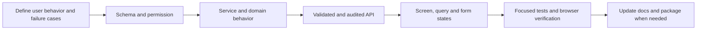

## 16. Boundaries and troubleshooting

| Symptom                                 | What to inspect first                                                                                           |
| --------------------------------------- | --------------------------------------------------------------------------------------------------------------- |
| Setup page is shown                     | No user exists in this instance. Use its setup token; sample and real instances have different files.           |
| Login opens instead of dashboard        | Account setup is complete, but the browser has no active session. Use the existing local credentials.           |
| CPU or throughput shows unavailable     | Wait for two usable scrapes; a restart, reset or long gap rebuilds the baseline.                                |
| Host is stale/offline                   | Inspect last success/error, exporter reachability from the API and configured scrape cadence.                   |
| A chart has gaps                        | Check real scrape failures, timestamp freshness, requested range and retention settings.                        |
| Docker is unavailable                   | Check DOCKER_ENDPOINT, private proxy reachability, socket group and permitted paths.                            |
| Restart is disabled                     | Check account role, API action flag and proxy restart policy; default behavior is disabled.                     |
| An alert does not recover during outage | Missing data deliberately cannot establish recovery. Wait for fresh measurements.                               |
| A notification fails                    | Inspect masked channel delivery status, outbound network reachability and the matching encryption key.          |
| Secure login fails over direct HTTP     | With TLS-proxy mode enabled, use the configured HTTPS origin.                                                   |
| Sample startup reports a busy port      | Stop your own earlier sample process or use SAMPLE_PORT, SAMPLE_EXPORTER_PORT and SAMPLE_DOCKER_PORT overrides. |
| Release smoke reports stale content     | Rebuild if code changed, repackage current documentation/assets, then rerun the smoke check.                    |

### Threat model and trust boundaries

| Boundary                                      | Risk                                                                    | Controls and remaining responsibility                                                                                                                                                                                                     |
| --------------------------------------------- | ----------------------------------------------------------------------- | ----------------------------------------------------------------------------------------------------------------------------------------------------------------------------------------------------------------------------------------- |
| Browser to API                                | Stolen sessions, cross-site mutations or unauthorized changes           | HttpOnly/SameSite cookies, TLS-proxy mode, CSRF, server-enforced roles, rate limits, bounded JSON and a restrictive CSP. Keep the deployment private and protect administrator accounts.                                                  |
| API to exporters, checks and channels         | A compromised administrator targets unintended network services         | Administrator-only destination configuration, URL validation, explicit metadata-target exclusions, no HTTP redirects and bounded network work. Private addresses are intentionally allowed; host/network egress policy remains necessary. |
| Exporter response to storage                  | Malformed data, excessive cardinality or disclosure of sensitive paths  | Parser/byte/deadline limits, finite/fresh metric checks and filesystem exclusions before persistence. Only capacity metadata is collected; there is no file browser.                                                                      |
| API to Docker                                 | Privileged Engine access or disclosure through container logs           | Internal restricted proxy, method/path policy, role guards, hide labels, audited logs and explicit restart gates. A read-only socket mount alone does not limit Engine operations.                                                        |
| Notification configuration and database files | Exposed destinations, credentials or persistent operational information | AES-256-GCM encrypted channel configuration, masked responses, hashed passwords/session identifiers and private host permissions. Back up the database and matching encryption key together.                                              |
| Database write to UI confirmation             | Disk exhaustion or write failure incorrectly appears successful         | Persistence failures become request errors; forms retain drafts rather than claiming success. Operators must monitor disk capacity and validate their backup/restore procedure.                                                           |

Private LAN URLs are intentionally allowed, because monitoring internal services is the product's purpose.
Administrator trust and host/network egress controls remain part of the deployment boundary. The application
rejects obvious prohibited metadata URLs and bounds network work, but does not claim DNS-rebinding isolation.
HTTP bodies are bounded, authentication is rate-limited, response errors include request IDs, and the browser
uses a restrictive CSP with self-hosted scripts/fonts and no telemetry.

SQLite is the only implemented database. There is no high-availability cluster, tenant isolation, durable
notification queue or continuous log stream. Physical-device/screen-reader testing, live providers, production
load and production backup/restore drills have not been established by the local sample suite. The recorded
font CSP messages and Node SQLite/build warnings are described in the verification report.

Continue with the [API reference](docs/API.md), [decision record](docs/ADR.md),
[feature matrix](docs/FEATURE_MATRIX.md), [release guide](docs/RELEASE.md) and
[known limitations](docs/KNOWN_LIMITATIONS.md) for narrower implementation and operating details.
