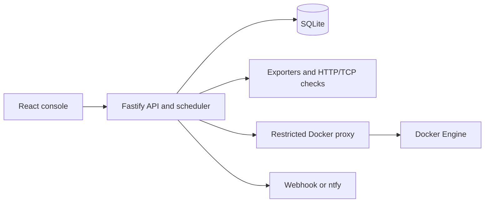
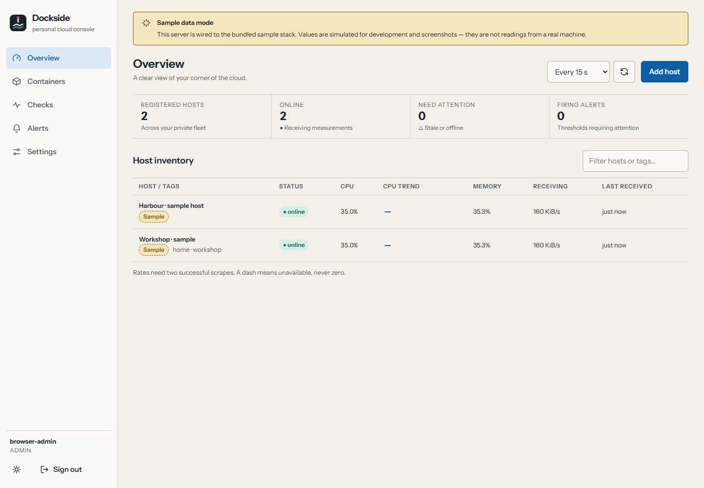

# Dockside

A private console for personal Linux servers: host metrics, Docker inspection, service checks and alerts.
The interface uses ruled tables, a fog/harbour theme pair and a persistent banner whenever sample mode is enabled.

**Start here:** [Architecture and complete flowcharts](ARCHITECTURE.md) · [API reference](docs/API.md) ·
[Verification report](docs/TEST_REPORT.md) · [Deployment and rollback](docs/RELEASE.md).

## What you can do

- Monitor CPU, memory, load, uptime, filesystem capacity, network/disk throughput and available temperatures.
- Inspect Docker state and bounded logs through a private restricted proxy.
- Run HTTP/TCP checks, inspect their history and configure host-metric alerts.
- Acknowledge or silence incidents and deliver webhook/ntfy notifications.
- Manage local viewer/operator/admin accounts and inspect sensitive-action audit history.
- Use light/dark themes, keyboard-accessible charts, data tables and layouts down to 320px.



The API collects and stores measurements even when the browser is closed. The browser reads the API through
one origin; it does not connect directly to exporters or Docker. This is one private fleet shared by its accounts.

## Quick preview with sample data

Requires Node **22.13.0 or newer** and npm. Docker and a real Linux exporter are not needed for this preview.
From the repository root:

```sh
npm ci
npm run build
npm run sample
```

Open **[http://127.0.0.1:8181](http://127.0.0.1:8181)**. On the first visit, read the setup token from
[`data/sample/setup-token`](data/sample/setup-token), then choose your administrator username and password.
There is no default password. Later visits use the credentials you created. Keep the runner open while testing.

Start with Overview, open the sample host, inspect a chart or its table, view container logs, and add an HTTP
check using `http://127.0.0.1:9187/metrics`. Allow two five-second scrapes for CPU and throughput rates. All
measurements and containers are simulated and labelled. Restart actions stay disabled in this mode.



## Run with real data locally

Prerequisites: Node **22.13.0 or newer**, npm, and an HTTP-accessible `node_exporter` for real host metrics.
Run these commands from the repository root:

```sh
npm ci
npm run bootstrap
npm run build
npm start
```

Open `http://localhost:8080`. The one-time setup token is in the generated `.env`; use it to create the first
administrator. Bootstrap never prints secrets and never overwrites an existing `.env`. An account is essential
because the console exposes private operational information. Remove `SETUP_TOKEN` after setup if desired.

To develop, run `npm run dev:api` and `npm run dev:web` in separate terminals, then open `http://localhost:5173`.
The API reads root `.env`; Vite proxies `/api`. Production serves the built SPA and API from one origin.
SQLite data defaults to `data/dockside.sqlite`, relative to the directory from which the API is started.

## Sample runtime and local modes

Open `http://127.0.0.1:8181`. Read the setup token from `data/sample/setup-token`.
The runner binds its exporter to `127.0.0.1:9187` and its fake Docker API to `127.0.0.1:9387`.
All measurements and container records in this mode are simulated. They are not real-machine verification.
Sample data and credentials persist under `data/sample`, independently of the real console database.
Stop with Ctrl+C. The runner refuses to reuse occupied ports; it never kills another application.

| Mode            | Browser URL                        | Data and configuration                                 |
| --------------- | ---------------------------------- | ------------------------------------------------------ |
| Sample preview  | `http://127.0.0.1:8181`            | `data/sample/`; simulated exporter and Docker fixtures |
| Built console   | `http://localhost:8080` by default | Root `.env`; `data/dockside.sqlite` by default         |
| Web development | `http://localhost:5173`            | Vite proxies `/api` to the API on port 8080            |

The server collection interval and browser refresh interval are independent. Screen refresh reloads stored
measurements; HTTP/TCP checks additionally provide a deliberate **Run now** action.

## Understand the code and development flow

[ARCHITECTURE.md](ARCHITECTURE.md) is the full guide for new contributors. It explains the five development
milestones and contains diagrams for the system boundaries, startup/shutdown, account setup, secured requests,
database relationships, collection/history, service checks, alert decisions/delivery, Docker access, navigation,
local/Linux deployment and release pipeline. Every major area links back to its implementation.

Recommended reading order: the architecture overview, shared contracts/roles, API startup/context, host service,
then the corresponding frontend screen. [ADR.md](docs/ADR.md) explains design tradeoffs and
the architecture guide describes the development milestones.

## Connect real services

Add a host using its private `http://<host>:9100/metrics` endpoint. CPU and throughput rates need two successful
scrapes. Missing exporter capabilities stay unavailable. The host detail screen includes filesystem capacity,
interfaces, temperatures when exposed, and charts with source, cadence, gaps, keyboard navigation and tables.

Configure `DOCKER_ENDPOINT` to a restricted private Docker proxy, never a public socket listener.
Containers labelled `dockside.hide=true` are omitted from listing and log access. Viewers cannot read logs.
Restart is disabled by default; enabling it requires both the API flag and proxy policy, plus an operator/admin
role and browser confirmation. The API audits reads of logs, denied actions and configuration changes.

Administrators add HTTP/TCP checks, alert thresholds, webhook/ntfy channels and users. Operators can run checks,
acknowledge alerts and silence them. All users share one fleet; this is a single-tenant application.

## Linux deployment

The Compose stack targets **rootful Docker on Linux**. It has not been started on this Windows workstation.
See [deployment and rollback](docs/RELEASE.md) before exposing the console remotely.

```sh
npm run bootstrap
# Edit .env: set DOCKER_GID from `stat -c '%g' /var/run/docker.sock`.
# Check NODE_EXPORTER_BIND_ADDRESS against your Docker bridge address.
docker compose config --quiet
docker compose up --build -d
```

Only `127.0.0.1:8080` is published for the API. The Docker proxy is on an internal network with no published port.
The exporter uses host PID/network namespaces and binds to the configured private Docker bridge address.
For remote access, use a VPN or the optional Caddy TLS profile; see the exact environment settings in the release guide.

## Verify and package

```sh
npm run format:check
npm run lint
npm run typecheck
npm run test
npm run test:coverage
npm run verify
npm run e2e
node scripts/check-deploy.mjs
npm run release
node scripts/smoke-release.mjs
```

`verify` includes formatting, lint, types, coverage and production builds. Every workspace enforces 90% statements,
branches, functions and lines. Playwright uses installed Edge by default; set `E2E_CHANNEL=chrome` for installed
Chrome or `E2E_CHANNEL=chromium` after installing Playwright Chromium. E2E uses isolated databases and sample ports.

Build outputs: `apps/web/dist/` and `apps/api/dist/server.mjs`. Release archives and SHA-256 files are under
`release/`; `release/latest.json` records the exact current filename, bytes, hash and version. The archive runs
with Node and contains the bundled API and web assets, not an APK or native installer.
The smoke script checks archive integrity and agreement with the current build/docs, then exercises bootstrap,
setup, CSRF, logout and saved check history across a server restart in an isolated temporary directory.
Implementation links in the architecture guide refer to the source checkout; the runtime archive contains the
bundled application and documentation rather than the original TypeScript source or the complete QA evidence.

## Project map and evidence

```text
apps/api/src/       routes, domain calculations, services, SQLite migrations
apps/api/tests/     auth, metrics, persistence, permissions and failure tests
apps/web/src/       feature screens, shared controls, tokens and client adapters
packages/shared/   Zod contracts, metric definitions and the permission matrix
deploy/            restricted Docker proxy and optional Caddy configuration
scripts/           bootstrap, sample services, deployment checks and release tools
e2e/               Edge/Chromium browser journeys and accessibility checks
qa/                screenshots, browser evidence and verification logs
ARCHITECTURE.md    complete architecture, threat model and development guide
docs/              decisions, API, test, release and compatibility reports
```

- [Architecture, threat model, development guide and flowcharts](ARCHITECTURE.md)
- [Decisions and design references](docs/ADR.md)
- [API contracts and permissions](docs/API.md)
- [Feature matrix](docs/FEATURE_MATRIX.md)
- [Verification report](docs/TEST_REPORT.md)
- [Compatibility](docs/COMPATIBILITY.md)
- [Known limitations](docs/KNOWN_LIMITATIONS.md)

No telemetry or third-party client requests are enabled. Preserve the database **and** `SECRETS_KEY` in private
backups; losing the key makes stored notification destinations unreadable. PostgreSQL is optional and not implemented.

## Current verification status

The implementation and local release are complete. Verification on **2026-11-05** passed 136 automated tests,
workspace coverage gates, production builds, two Edge browser journeys and 24 accessibility scans. The extracted
archive also passed setup, CSRF, logout and restart-persistence checks. These results and their limits are in the
[verification report](docs/TEST_REPORT.md).

Clean Linux Docker/Compose startup, real Engine/TLS behavior and remote CI still require verification. The
sample preview is a way to explore the app; it does not establish production deployment readiness.
